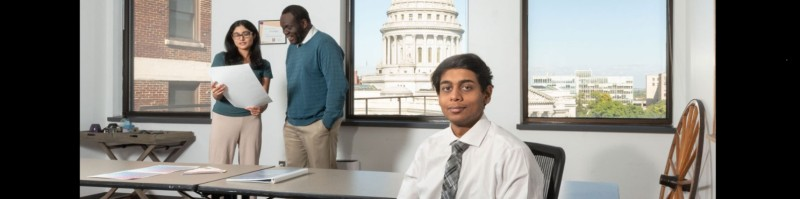

# Palash Goyal

**Software Engineer II @ JPMorgan Chase | Applied AI & Systems Researcher | Pianist**  
New York City, NY · B.S. Computer Science & Data Science, UW–Madison

---

### Featured Repositories

| Repository | Stack | Overview |
| :--- | :--- | :--- |
| [**Creative-Chat-Bot**](https://github.com/palash176/Creative-Chat-Bot) | `Python` `GANs` `NLP` | End-to-end multimodal ML pipeline translating speech/text queries into 3D avatar video responses. Published in the *Journal of Undergraduate Science and Technology* (2023). |
| [**EEG-Emotion-predictor**](https://github.com/palash176/EEG-Emotion-predictor) | `Python` `Scikit-Learn` `Signal Processing` | Raw EEG signal extraction and emotion classification (QDA, KNN, SVM) operationalizing affective cognitive models. Presented at *The Science of Consciousness* (2024). |
| [**ResumeMatchSearch**](https://github.com/palash176/ResumeMatchSearch) | `Python` `OracleDB` `NLP` | Full-stack application enabling recruiters to query an Oracle database of resumes using natural language search. |
| [**QRCodeGenerator**](https://github.com/palash176/QRCodeGenerator) | `TypeScript` `Full-Stack` | Enterprise web application generating Base64 PNG QR codes for links and structured user records. |
| [**BullyingProject**](https://github.com/palash176/BullyingProject) | `Python` `TensorFlow` `CNNs/LSTMs` | Computer vision and multimodal ML pipeline fusing CCTV frame analysis (Darknet-19/CNNs) with behavioral records to detect K–12 bullying. |
| [**RemoteSqlConnection**](https://github.com/palash176/RemoteSqlConnection) | `Java` `PostgreSQL` | Reusable Java utility for extracting and streaming PostgreSQL data into remote environments for downstream analytics. |

---

### Selected Applied Research & Industry Systems

* **Decentralized Water Credit Ledger (Climate Tech):** Architected a cryptographic credit mechanism to make Atmospheric Water Generators (AWGs) economically viable in water-scarce regions. Featured in *Thinking for Our Planet* (Gov. of India, 2023) and presented as an invited panel speaker at **ASU's Third Annual International Water Harvesting Summit** (Jan 2026).
* **detectDfect (Industrial Computer Vision):** Built a 16fps camera-triggered YOLOv8x defect detection and structural-life regression pipeline for moving steel rails, currently in testing at Bhilai Steel Plant.
* **AFRL Space C2 & Warfighter AI:** Developed an OPIR-informed satellite prioritization model (Random Forest + CNNs, 90% accuracy) for AFRL Dragon Army (2023) and a fine-tuned bidirectional BERT real-time stress detection prototype for AFRL's Tailored Expressive Dialogue System (2024).

---

### Publications & Patents

- **Goyal, K., Dixit, R. S., Choudhary, S. L., & Goyal, P.** (2026). [*Consciousness-induced AI for decision-making in the fast-moving consumer goods sector: a systematic literature review.*](https://doi.org/10.1080/2573234X.2026.2617555) **Journal of Business Analytics**.
- **Goyal, K., Goyal, P., & Goyal, A. V.** (2025). [*Non-invasive EEG signal processing pipeline for Sāṅkhya Triguṇa cognitive modeling.*](https://client2021.nsllegal.com/Public/JPatent/PJ_23May2025.pdf) **Indian Patent App 202511038630 A** & Live Demo at **MBCC, IIT Mandi**.
- **Goyal, K., Goyal, A. V., & Goyal, P.** (2024). [*Raw EEG computational extraction & emotion classification (QDA, KNN, SVM).*](https://consciousness.arizona.edu/sites/consciousness.arizona.edu/files/2024-03/3-25c%20TSC%20Program-Abstracts.pdf) **The Science of Consciousness**, Tucson, AZ.
- **Goyal, P.** (2023). *End-to-End Multimodal Machine Learning Pipeline for Speech-to-Video Translation.* **Journal of Undergraduate Science and Technology (JUST) Fall 2022** *(First Author)*. https://www.drive.google.com/file/d/1FY68lMYMnO8qzipdNSl1VKp9obB5nKu3/view?usp=sharing 
- **Agrawala, P., Goyal, K., & Goyal, P.** (2023). [*Decentralized credit ledger mechanism for large-scale atmospheric water harvesting.*](https://www.niti.gov.in/sites/default/files/2023-06/Thinking-For-Our-Planet-75-Ideas-to-Promote-LiFE.pdf) **Thinking for Our Planet** (Gov. of India).
- **Kumar, L., Goyal, P., Malik, K., et al.** (2021). [*Using Machine Learning, Image Processing and Neural Networks to Sense Bullying in K-12 Schools: Enhanced.*](https://doi.org/10.1007/978-981-16-2641-8) **Springer LNNS (SSIC 2021)**.
- **Hasnain, S., Goyal, P., & Kumar, R.** (2021). [*Creativity in Machines: Music Composition Using Artificial Intelligence that Passes Lovelace 2.0 Test (PALASH 1.0).*](https://doi.org/10.1007/978-981-16-3246-4_26) **Springer ICCT**.
---

### Experience & Education

* **JPMorgan Chase** — Software Engineer II, Data Technology *(Apr 2026 – Present · New York City, NY)*  
  Scaling multi-cloud GenAI infrastructure and multi-agent systems (34k+ users, 100+ LLM use cases); automated week-long cloud provisioning to under 1 hour.
* **Sentry Insurance** — Software Developer, Application Services *(Sep 2024 – Apr 2026 · Stevens Point, WI)*  
  Deployed *Seeker* (firm-wide LLM RAG agent on vector DBs) and drove claims integration migrating 300M+ documents during the $1.7B acquisition of The General.
* **Air Force Research Laboratory (AFRL)** — Research Scholar *(Summers 2023 & 2024 · Dayton, OH & Colorado Springs, CO)*  
  NLP/Transformer stress detection (711th Human Performance Wing) and Space C2 threat prioritization (Dragon Army).
* **University of Wisconsin–Madison** — B.S. in Computer Science & Data Science *(2021 – 2024 · 3.69 GPA)*  
  Completed dual degree in 3 years. Recipient of the **Wai Yin Yick Endowment** and **Thermo Fisher Scientific STEM Scholarship**.

---

### Technical Stack

| Area | Technologies |
| :--- | :--- |
| **Languages** | Python, Java, C#, C/C++, TypeScript, JavaScript, SQL, Bash |
| **AI / ML** | PyTorch, TensorFlow, Keras, Scikit-Learn, LLMs, RAG, Transformers (BERT), YOLOv8, OpenCV, NLTK |
| **Cloud & Systems** | AWS (Bedrock, Developer-Proficiency), GCP (Vertex AI), Docker, Kubernetes, Apache Spark, Jenkins, CI/CD |
| **Databases** | PostgreSQL, OracleDB, MongoDB, MySQL, Microsoft SQL Server, Neo4j |

---

### Beyond Engineering

I hold a **Grade 8 Trinity Classical Piano** certification and co-founded **Music for All**, providing free music instruction during and after the pandemic (including teaching at the Monroe Street Arts Center in Madison). I also volunteer through **JPMC GoodWorks** and previously served as a **Badger Volunteers** team lead mentoring underserved youth.
